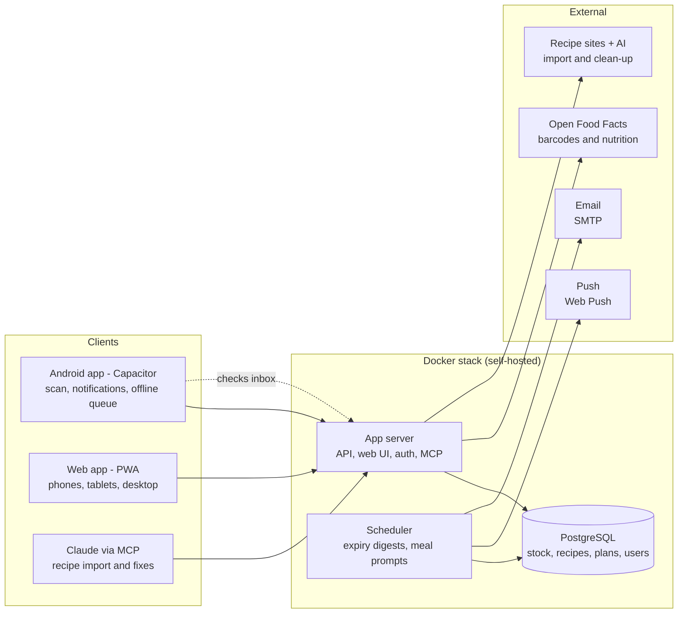

# Snack Overflow — Design Spec

## Overview

A self-hosted household food app: scan food in and out fast, see what is going off, plan meals around what you already have, and build a cheap shopping list that wastes as little as possible. It is a fresh build, not a Grocy fork. It borrows Grocy's good ideas (stock entries, locations, unit conversions) but is designed around the waste-aware planner, which Grocy's internals would fight.

**Principles**

- **Fast over exact.** Scanning feels like a supermarket till: beep, big green tick, next item. Estimates are accepted silently and fixed later if needed.
- **Never a rigid flow.** Freeze, defrost, open and cook are all optional steps. You can always just use or remove something.
- **The app does the bookkeeping.** It tracks grams in the background and only asks a quick question when its numbers might be wrong ("Is there still some left?").
- **One household, many phones.** Everyone sees the same stock, plan and list in real time.

**In scope:** pantry stock with locations and best-before dates, barcode scanning, opened/frozen tracking, recipes with import, meal planner with per-person calories, batch cooks and leftovers, a single shopping list, waste-aware meal suggestions, optional pricing, notifications, user management, a dashboard, Docker deployment, an Android companion app.

## Design notes

**Batches stay hidden.** Each scan is stored as its own pack with its own best-before date, because two bags of potatoes bought a week apart really do expire on different days. Users never manage batches. The stock screen shows one row per item ("Potatoes · 2 packs · earliest 14 Nov"), and tapping it shows the individual packs. When something is used, the app takes from the pack that expires first.

**Pack sizes are what make the shopping list cheap.** Recipes ask for exact amounts, but shops sell fixed packs. Example: a fish pie needs 100g of potatoes and there are none. The list can't say "buy 100g"; it says "buy a 2.5kg bag", which leaves 2.4kg spare. Because the app knows the usual pack size, it can show that surplus straight away and suggest more meals this week that use it up. Pack sizes come from the barcode record, so users rarely enter them.

## Data model

The key split is **Ingredient** (generic, e.g. "Potatoes", what recipes use) versus **Product** (a specific barcode, e.g. "Aldi Maris Piper 2.5kg", what you scan). A product links to one ingredient, or to none for things like a Pot Noodle or a Snickers. Those can still be planned, eaten and tracked for calories, but never appear in recipe matching.

| Entity | What it holds | Notes |
| --- | --- | --- |
| Household | Name, settings, default locations | One per install to start; the model allows more later |
| User | Name, email, role (admin / member), notification preferences | Admins manage users and settings |
| Location | Name, type (cupboard / fridge / freezer), icon | Type drives shelf-life rules, e.g. freezer dates |
| Ingredient | Name, category, base unit, unit conversions, shelf life (closed / opened / frozen / defrosted), nutrition per 100g, typical pack sizes, "track running low" flag | Generic; shared by recipes, plan and list |
| Product | Barcodes, name, brand, image, pack size, nutrition, linked ingredient (optional), learned shelf life, last known price | Created from Open Food Facts or by hand on an unknown scan, then remembered |
| Stock item | Product, location, quantity left (grams), state (closed / opened / frozen / defrosted), best-before, added / opened / frozen dates, added by | One per scanned pack; also used for leftovers and batch-cook portions |
| Stock event | Type (add, use, open, move, freeze, defrost, discard, adjust), quantity, user, time, link to meal | Audit log; powers undo, waste stats and usage-rate estimates |
| Recipe | Title, serves, steps, image, source URL, tags, prep/cook time, nutrition per serving (calculated) | Imported or typed in |
| Recipe ingredient | Ingredient (or product), amount, unit, note ("finely chopped"), optional flag | Amount converted to grams for matching |
| Meal plan entry | Date, slot (breakfast / lunch / dinner / snack), recipe, product or leftover, servings, status (planned / cooked / skipped), people | Products allowed, so a Snickers can be logged; people optional, each with their portions, for per-person calories |
| Shopping list item | Ingredient, product or free text, amount, pack count, reason (plan / running low / manual), checked, added by | One shared list |
| Price | Product, store, price, date, source (manual / scan / Open Prices) | Only used when pricing is switched on |

**Units.** Everything is stored in grams. Each ingredient has conversions to grams: weight units are fixed (1kg = 1000g, 1lb = 454g), volume uses a density (1ml of water = 1g, 1ml of flour ≈ 0.53g), and counts use a per-ingredient weight (1 onion ≈ 150g, 1 tin ≈ 400g). The app ships with sensible defaults for common UK ingredients and spoon/cup measures. A recipe can use any unit; the app converts it for matching and shows it as written.

## Key workflows

Every workflow is optional and can be undone. The app keeps the numbers right in the background and asks a quick question only when it is unsure.

**Scan in (the till experience)**

1. Tap the big Scan button, choose a location (it remembers the last one).
2. The camera stays open. Each barcode gives a beep, a full-screen green tick, and a strip showing the name and estimated best-before. Scanning the same item three times adds three packs.
3. Unknown barcode: amber flash and a small sheet asking for the name, pack size and which ingredient it is (suggested). Saved once, it is recognised forever by the whole household.
4. Tap Done to see a summary of the session, where any date or location can be fixed. Undo is available on every scan.

Best-before estimate order: what was set last time for this product, then the product's category default, then the ingredient's default. Changing a date teaches the app (always changing a product to 4 days makes 4 days its new default).

**Scan modes**

The scanner has three modes, switched at the top of the camera screen:

- **Add:** puts the item into stock at the chosen location.
- **Use:** takes the item out of stock (cooking, partial use).
- **Eat:** logs the item to the current person's meal slot for calorie tracking (e.g. "Snickers → your lunch, 250 kcal") and, if it is in stock, takes it out of stock too.

**Use something**

- From the item (tap, then Use), or scan in "Use" mode.
- Quick choices: Used it all / Some (¼, ½, ¾) / Exact amount. Exact is never required.
- When a closed item is used for the first time, a prompt asks "Is it opened now?". Yes sets the best-before to the earlier of the current date and the opened shelf life (e.g. pesto: 14 days).
- When the tracked amount gets close to zero, or looks off after a rough "some", the app asks "Is there still some left?" with Yes / Nearly gone / None.
- If using something would leave a planned meal short, a warning appears ("This leaves 50g for Fish pie on Thursday") with Use anyway / Cancel / Add to shopping list.
- Discard (binned it) is separate from Use, so waste can be counted.

**Freeze and defrost**

- "Move to freezer" moves the pack and sets the best-before from the frozen shelf life (e.g. raw chicken: 3 months, bread: 3 months).
- Expiry warnings offer "Freeze it" as a one-tap action.
- Defrost is optional: it moves the pack to the fridge and sets a short date (e.g. 1 day). Items can also be used or cooked straight from the freezer.

**Cook a planned meal**

1. At the slot's time (e.g. 6pm for dinner) a notification asks "Cooking Fish pie tonight?" with Cooked / Skip / Move.
2. Cooked opens a confirm screen with every deduction prefilled from stock, earliest-expiring first. Adjust any line, or tick "didn't use".
3. Any opened prompts appear, then "Any leftovers?" asks for portions and a location.
4. Leftovers become stock items ("Fish pie · 2 portions · fridge · use by Sat") that can be planned like any meal.

**Batch cook**

- From a recipe, choose Batch cook and a multiplier (e.g. ×3). Ingredients are deducted in one step.
- Split the portions between locations (2 fridge, 6 freezer). Each group gets its own best-before.
- Portions show in the calendar under "From your freezer", and the optimiser favours them before cooking something new.

## Recipes, planning and the waste optimiser

**Recipes**

- Import from a URL. Most recipe sites (BBC Good Food, Hello Fresh, blogs) embed schema.org Recipe data (JSON-LD), which gives an accurate first pass.
- An optional AI clean-up, run only when the user taps it, fixes messy imports and matches each line to an ingredient ("2 large Maris Pipers, peeled" becomes Potatoes, 2 × ~250g). The user reviews matches before saving. Requires an API key in Settings; hidden when none is set.
- An MCP endpoint lets Claude (or another assistant) add or fix recipes directly, e.g. from a photo of a recipe card. This does the clean-up through the user's own assistant, so no API key is needed.
- Every recipe has a "serves" number. Servings can be scaled when planning or cooking.
- Calories and macros per serving are calculated from the linked ingredients.

**Planner**

- Week view with breakfast, lunch, dinner and snack slots. Plan ahead for a whole week, or add things on the day as you go.
- A slot holds any number of items: recipes, products (a Snickers bar, a banana, a coffee), leftovers or batch portions, or free text. Each item has its own calories.
- Food can be logged into a slot by scanning it (Eat mode), searching, or picking from stock.
- Daily calorie totals come from what is planned or logged.
- Planned meals don't lock stock. Stock shows what is earmarked ("500g, 100g planned"), and using or removing something that would leave a planned meal short gives a warning.

**People and calendars.** Each person sees the planner as their own calendar. When a planned meal serves more than one, the app asks who is eating (optional; skipping it plans the meal for the household). Assigned people get their share of the calories. Admins can view and edit other people's calendars. Anyone who doesn't want calorie tracking can ignore it; nothing is forced.

**Finding meals**

- **Cook now:** recipes you can make entirely from stock.
- **Nearly there:** recipes missing 1–3 ingredients, listed with what is missing.
- **Use it up:** recipes ranked by how much soon-to-expire food they use.

**The optimiser**

It works out the surplus for every ingredient: what you have, plus what the shopping list will bring in (rounded up to whole packs), minus what the plan needs. Surplus that will go off before it is used gets a score based on its expiry date. Recipes are then ranked by how much at-risk surplus they use, minus the cost of any extra ingredients they would need.

- **Suggest meals:** shows the top suggestions with a reason ("uses your 400g spare potatoes and the spinach going off Thursday"). The user picks.
- **Plan my week:** fills the empty slots automatically, then lets the user swap or remove anything before it is final.
- Rules it respects: servings, no repeat within N days (default 7), excluded tags, and a cap on extra ingredients.
- Surplus hints also show on the plan and list ("2.1kg potatoes spare after this plan").
- Scoring, as built: every 100g of at-risk surplus a recipe uses scores 1 point times how soon it goes off (1 / (1 + days left / 2), so food going off today counts most); frozen food, food past its date and food still on the list don't count as at risk. Extras cost 1 point per ingredient to buy, or, with pricing on and prices known, 0.5 points per pound. Recipes needing more than the cap of extras are left out.
- Plan my week puts leftovers in the fridge into the earliest empty slots before their date, then fills the rest one day at a time (re-working the surplus after each pick, so two recipes don't both count the same spinach). On a day where nothing at risk would be saved, a portion from the freezer comes before cooking from scratch. Each recipe is picked at most once a week, and "no repeat" counts recipes cooked or planned in the last N days.
- The rules (no-repeat days, excluded tags, cap on extras) are household settings, under Settings → Meal suggestions.

## Shopping list, pricing and notifications

**Shopping list.** Planning and shopping are separate steps: make a plan, then tap "Build list from plan". There is one shared list, grouped by category (veg, dairy, tins...), and the user decides which shop to visit.

- Plan items: what the plan needs, minus stock, minus what is already on the list, rounded up to whole packs.
- Running low: staples like salt or oil are flagged "track running low". The app estimates when they will run out from usage rate, and adds them or sends a reminder. One tap marks anything as running low.
- Manual items, free text allowed.
- Items on the list count as "coming" in the planner and optimiser.
- **Put away mode:** after shopping, ticked items can be scanned in (best-before estimated as usual) or added in one tap using the default product.

**Receipts: add a whole shop at once.** Instead of scanning every barcode, the user can hand the app a receipt:

- **Photo:** take a picture of a paper receipt in the app (long receipts in several shots).
- **Upload or share:** a photo, PDF or screenshot, using the phone's share sheet into the Android app or upload on the web.
- **Email forward:** forward an online-order confirmation (Tesco, Asda, Sainsbury's, Ocado...) to a mailbox the app checks. Online orders are the most accurate source because they carry full product names, quantities and prices.

How it works:

1. The receipt is read into lines (item text, quantity, price, store, date). Photos and PDFs go through AI vision (optional key) or the MCP endpoint, so it works without a paid API key; email orders are parsed from their text.
2. Each line is matched to a product: first lines this household has matched before (receipt abbreviations like "TES SEMI SKM MLK 4PT" are learned once and remembered), then the shopping list, then product names, then Open Food Facts search.
3. A review screen shows every line with its match, quantity, location (from the item's usual location) and estimated best-before. Uncertain matches are highlighted; non-food lines (bags, toiletries) are skipped automatically. The user fixes anything and taps "Add to stock".
4. Matched items are added to stock in one go, ticked off the shopping list, and their prices are saved (this is the best source of real prices for the optimiser).

Receipt items have no barcode, so if a product was never scanned the app links the barcode later the first time it is scanned. Photos of receipts are kept with the receipt as a compressed JPEG (shrunk to 1600px before upload) so they can be looked at again; uploaded PDFs are dropped once the receipt has been reviewed.

**Pricing (optional, off by default).** No UK supermarket has a public price API, and scraping their sites is fragile and against their terms. Prices come from:

- what the user types when scanning (optional field, never required),
- Open Prices, the crowd-sourced price database run by Open Food Facts,
- receipts (see above): the main automatic source.

When prices exist, the list shows an estimated total and the optimiser uses them. When they don't, it falls back to "fewest extra items". Turning pricing off hides it everywhere.

**Notifications.** Each user picks channels per notification type and sets quiet hours.

| Notification | Default timing | Channels |
| --- | --- | --- |
| Weekly "going off this week" summary | Sunday 10am | Push, email |
| Expires tomorrow (with Use / Freeze / Binned buttons) | Daily 9am | Push |
| Meal-time "Did you cook it?" | Slot time (e.g. 6pm dinner) | Push |
| Running low | When estimated | Push |
| Shopping list changed by someone else | Off | Push |

Every notification also lands in an in-app inbox (the bell on Today). The Android app checks that inbox in the background, about every 15 minutes, and shows it as a normal phone notification, with no Firebase or Google push service involved; while the app is open it updates instantly over the live connection. Browsers get Web Push. Email uses a configurable SMTP server. Channels per notification type: phone app / in-app, Web Push, email.

## Screens

Phones have five tabs (Today, Stock, Scan, Calendar, Shop) with Scan as a large centre button; Recipes, Batch cooks, Receipts, Dashboard, Waste report and Settings are in a menu at the top left. On desktop there is no bottom bar: everything is in a collapsible left sidebar. Products & barcodes, Ingredients & units, Locations, People & roles, Notifications and your profile live under Settings, which has its own sub-menu. The planner is called the **Calendar**, because it shows calories as well as plans (old /plan links still work).

| Screen | Main content | Key actions |
| --- | --- | --- |
| Today (home) | Today's meals, "use soon" strip (next 3 days), running-low nudges, quick stats | Cooked / skip, Use / Freeze from the strip |
| Stock | A table with quick filters (All / Fridge / Freezer / Cupboard), search, filter, sort and group; columns Where, State (opened, frozen, defrosted), Packs, Left (ml for liquids), Planned (shown red when there isn't enough for the planned meals, or with the shopping-list mark when it's on the list) and Best before | Use, Freeze or Defrost, Move, Bin on every row; Mark as opened and details in "⋯"; tick rows for bulk actions |
| Scan (centre) | Full-screen camera, location (or meal slot) chip, mode switch (Add / Use / Eat), session counter | Continuous scan, undo, Done summary |
| Calendar | Week grid per person with meal slots and daily calories, and a right-hand pane of stock, recipes and leftovers | Drag from the pane onto a day and meal, drag a planned meal to move it (both undoable), +Add, Suggest meals, Plan my week, Build list |
| Shopping | One list grouped by category, estimated total if pricing is on, surplus hints | Tick off, Put away mode, Add item, Add from receipt |
| Receipt review | Each receipt line with its matched product, quantity, location, best-before and price; uncertain matches highlighted | Fix match, skip line, Add to stock |
| Recipes (from Calendar and Today) | Library with Cook now / Nearly there / Use it up filters | Import URL, Cook, Batch cook, Add to plan |
| Item detail | Packs with dates and locations, history, product info, shelf-life settings | Edit dates, link to ingredient, merge duplicates |
| Dashboard (from Today) | Calories per day with 7- and 30-day averages against each person's daily target; waste per week/month by item and category (kg, and £ if pricing is on); spending from receipts when pricing is on | Switch person (admins), 7 / 30 days |
| Waste report (menu) | What was binned by week or month: a chart of the last 8 weeks or 6 months, by item and by category | Week / month |
| Settings | Household, users and roles, locations, notifications, pricing toggle, AI import key, shelf-life defaults, backups | Invite user, export data |

Dashboard details, as built:

- Calories count meals marked eaten (Cooked it, Eat mode, or logged as eaten). Averages leave out today and days with nothing logged, since an empty day means nobody logged it. Each person can set a daily calorie target in their profile (admins can set anyone's); days over it show in violet. Members see their own calories and the household's; admins can switch to anyone.
- "Down 40% on October" compares like with like: on 12 November, 1–12 November against 1–12 October.
- The value of binned food uses the product's latest price per gram, else the ingredient's cheapest known price; spending is the sum of reviewed receipts. Both hide when pricing is off.
- Charts are plain HTML columns with a tooltip on hover or focus and the numbers as a table, so they work with a screen reader and without colour.

Visual direction (details in `docs/design/README.md`): a desktop data tool in the style of Airtable that also works on phones. A collapsible sidebar with icons, a toolbar with search, filter, sort and group on every list, dense tables with each row's actions always visible (Use, Freeze, Move, Bin on stock), ticking rows for bulk actions, and a side panel for one record (linked in the address, closed with Back or Escape). Phones get the same components as compact lists, with the bottom bar and Scan button. Colours come from eight palettes (Blue by default) chosen per device in Settings → Appearance, with light, dark and match-device themes; green, amber and red are reserved for freshness, and frozen food has its own colour and a snowflake. Inter for text. The original phone-first mock-ups are in `docs/design/legacy/`.

## Architecture and tech stack

One Docker Compose stack runs everything. The Android app wraps the same web UI and adds native scanning, phone notifications (from the app's inbox, no Firebase) and an offline queue.

| Layer | Choice | Why |
| --- | --- | --- |
| Language | TypeScript everywhere | One language for server, web and app; shared types |
| Web UI | React + Vite, installable PWA, Tailwind CSS | Fast, polished mobile UI that can be installed from the browser |
| Server | Node.js with Fastify, REST API with live updates over WebSockets | Light, quick, easy to run in Docker |
| Database | PostgreSQL with Drizzle ORM | Reliable, good for the matching queries, simple migrations |
| Android app | Capacitor wrapper around the web UI | Reuses all screens; adds native ML Kit barcode scanning, background notification checks and local storage. Signs in with a per-device token |
| Browser scanning | Built-in BarcodeDetector with a ZXing fallback | Works on the web too, not just the app |
| Offline | Queue of actions stored on the phone, synced on reconnect | Covers patchy signal; assumes online normally |
| Auth | Built-in email and password, or sign-in through a self-hosted identity provider (e.g. Pocket ID, Authentik, Authelia) over OpenID Connect; admin and member roles; invite links | User management built in |
| Jobs | Built-in scheduler in the app container | No extra services to run |
| Deployment | Docker Compose: app + Postgres, behind an HTTPS reverse proxy | Simple self-hosting |

Configuration and secrets come from environment variables (`.env`, never committed); an `.env.example` documents them.

## Build phases

Each phase ends with a working, deployable app.

1. **Foundation and stock.** Docker stack, users and household, locations, ingredients and products, Open Food Facts lookup, scan in/out, stock screen, open / freeze / defrost / discard, best-before estimates and learning, expiry notifications (web push and email), backups.
   The scanner's **Eat** mode logs food to a meal slot, so it ships with the planner in phase 4; phase 1 has Add and Use. The Plan and Shop tabs show a "coming soon" note until then.
2. **Android app.** Capacitor wrapper with native scanning, phone notifications (background check of the in-app inbox, no Firebase), offline queue for scans (also in the web app).
3. **Recipes and cooking.** URL import, AI clean-up, MCP endpoint, unit conversions, ingredient matching, cook with deductions, leftovers, batch cooks, calories.
4. **Planner and shopping list.** Per-person week planner, planned-stock warnings, meal-time prompts, build list from plan with pack rounding, running-low tracking, put-away mode.
   **Receipts:** photo / upload / share and email-forward import, line matching with learned abbreviations, review screen, add to stock, tick off the list, save prices.
5. **Optimiser and pricing.** Cook now / Nearly there / Use it up, Suggest meals, Plan my week, surplus hints, optional pricing with Open Prices.
6. **Polish.** Dashboard (calories per day and averages per person, waste and spending stats), design refinements from real use.

## Decisions

- **Name:** Snack Overflow.
- **Calories:** tracked per person; people on a meal are optional; each person has their own calendar; admins can see and edit others'.
- **Sign-in:** built-in accounts plus optional self-hosted identity provider over OpenID Connect.
- **AI recipe clean-up:** optional and manually triggered in the app; also available through MCP so no API key is required.
- **Grocy:** no import needed.
- **Shelf life:** start from UK food-safety defaults, learn from edits.
- **Dashboard:** calories per day and averages, plus waste stats.
- **Planned stock:** planned meals warn rather than lock stock.
- **Receipts:** photo, upload/share and email-forward import, built with the shopping list in phase 4.
