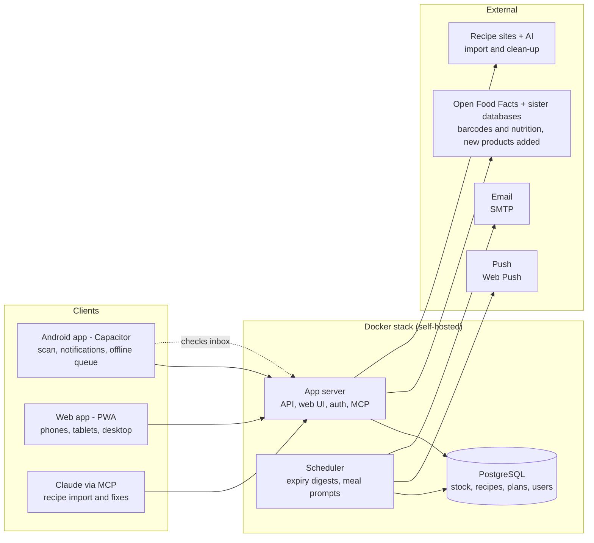

# Snack Overflow — Design Spec

## Overview

A self-hosted household food app: scan food in and out fast, see what is going off, plan meals around what you already have, and build a cheap shopping list that wastes as little as possible. It is a fresh build, not a Grocy fork. It borrows Grocy's good ideas (stock entries, locations, unit conversions) but is designed around the waste-aware planner, which Grocy's internals would fight.

**Principles**

- **Fast over exact.** Scanning feels like a supermarket till: beep, big green tick, next item. Estimates are accepted silently and fixed later if needed.
- **Never a rigid flow.** Freeze, defrost, open and cook are all optional steps. You can always just use or remove something.
- **The app does the bookkeeping.** It tracks grams in the background and only asks a quick question when its numbers might be wrong ("Is there still some left?").
- **One household, many phones.** Everyone sees the same stock, plan and list in real time.

**In scope:** pantry stock with locations and best-before dates, barcode scanning, opened/frozen tracking, recipes with import, meal planner with per-person calories, batch cooks and leftovers, a single shopping list, waste-aware meal suggestions, optional pricing, notifications, user management, a dashboard, Docker deployment, an Android companion app.

## Design notes

**Batches stay hidden.** Each scan is stored as its own pack with its own best-before date, because two bags of potatoes bought a week apart really do expire on different days. Users never manage batches. The stock screen shows one row per item ("Potatoes · 2 packs · earliest 14 Nov"), and tapping it shows the individual packs. When something is used, the app takes from the pack that's already open, then the one that expires first, and never asks which.

**Pack sizes are what make the shopping list cheap.** Recipes ask for exact amounts, but shops sell fixed packs. Example: a fish pie needs 100g of potatoes and there are none. The list can't say "buy 100g"; it says "buy a 2.5kg bag", which leaves 2.4kg spare. Because the app knows the usual pack size, it can show that surplus straight away and suggest more meals this week that use it up. Pack sizes come from the barcode record, so users rarely enter them.

## Data model

The key split is **Ingredient** (generic, e.g. "Potatoes", what recipes use) versus **Product** (a specific barcode, e.g. "Aldi Maris Piper 2.5kg", what you scan). A product links to one ingredient, or to none for things like a Pot Noodle or a Snickers. Those can still be planned, eaten and tracked for calories, but never appear in recipe matching.

| Entity | What it holds | Notes |
| --- | --- | --- |
| Household | Name, settings, default locations | One per install to start; the model allows more later |
| User | Name, email, role (admin / member), notification preferences | Admins manage users and settings |
| Location | Name, type (cupboard / fridge / freezer), icon | Type drives shelf-life rules, e.g. freezer dates |
| Food group (Category) | One of 17 fixed groups (Meat, Fish & Seafood, Fruit, Vegetables, Bread & Bakery, Dairy, Grains & Cereals, Tinned & Canned Food, Frozen Food, Dried Food, Chilled & Prepared Food, Snacks, Sweets & Confectionery, Sauces & Condiments, Herbs & Spices, Oils & Fats, Drinks) | Ingredients get theirs from the seed data; a product can override its ingredient's |
| Ingredient | Name, category, base unit, unit conversions, shelf life (closed / opened / frozen / defrosted), nutrition per 100g, typical pack sizes, "track running low" flag | Generic; shared by recipes, plan and list |
| Product | Barcodes, name, brand, image, pack size, serving size (from the label, via Open Food Facts), nutrition, linked ingredient (optional), learned shelf life, last known price | Created from Open Food Facts or by hand on an unknown scan, then remembered; can be added to Open Food Facts |
| Stock item | Product, location, quantity left (grams), state (closed / opened / frozen / defrosted), best-before, added / opened / frozen dates, added by | One per scanned pack; also used for leftovers and batch-cook portions |
| Stock event | Type (add, use, open, move, freeze, defrost, discard, adjust), quantity, user, time, link to meal | Audit log; powers undo, waste stats and usage-rate estimates. A use of a negative amount is food put back (a diary line's amount went down, or it was unticked or removed) |
| Recipe | Title, serves, steps, image, source URL, tags, prep/cook time, nutrition per serving (calculated) | Imported or typed in |
| Recipe ingredient | Ingredient (or product), amount, unit, note ("finely chopped"), optional flag | Amount converted to grams for matching |
| Meal plan entry | Date, slot (breakfast / lunch / dinner / snack), what it is (recipe, product, leftover, generic food, takeaway menu item or free text), servings, status (planned / cooked / skipped), people, batch flag | One timeline for plans and the food diary: planned meals and food logged as eaten are the same thing at different times. Products and generic foods are allowed, so a Snickers or a banana can be logged; a takeaway keeps a copy of its menu item's name and calories. People each have their portions and tick them off when eaten (anyone can tick for anyone); servings nobody has are free; a batch cook is eaten by nobody. A food or leftovers line records whether it comes from stock and owns what it took (its stock events link back to it); a cooked recipe records the servings kept as leftovers |
| Favourite food | Person, food (product, recipe, generic food or menu item) | Starred in Log food; each person has their own |
| Saved meal | Person, name, foods with amounts (and a copy of each one's name, calories and macros) | "My usual breakfast", logged in one tap |
| Staple | Ingredient or product, the level to keep (in the food's own unit: g, ml, items, or packs of a product) | Food to always have in: below its level it puts itself on the shopping list |
| Shopping list item | Ingredient, product or free text, amount, pack count, reason (plan / running low / manual), category (set on the list), checked, added by | One shared list |
| Price | Product, store, price, date, source (manual / scan / Open Prices) | Only used when pricing is switched on |
| Open Food Facts product | Barcode, name, brand, quantity, categories, image, nutrition per 100g, scan count | The optional local copy of Open Food Facts for the household's country; install-wide, refreshed from their export |
| Chain | Restaurant, takeaway, café or drink chain: name, type of food, nicknames, notes, where its nutrition came from and when | Install-wide reference data from `docs/data/chains.csv`, not per household |
| Chain menu item | Chain, name, menu section, serving (and its weight when published), kcal, fat, saturates, carbs, sugars, fibre, protein, salt per serving as sold | From `docs/data/chain-menus/<chain>.csv`; values the chain doesn't publish stay empty, never estimated |

**Fast food and takeaways.** UK chains with 250 or more staff must show calories on their menus, and most publish full nutrition. The app ships these as seed data: `chains.csv` lists the chains and `chain-menus/<chain>.csv` holds each chain's menu with nutrition per item as sold, taken only from the chain's own UK website, PDF or menu data (never third-party sites) and recorded with the source and date. On start-up the server copies them into the database, rewriting only chains whose files changed; items keep their ids while their name and serving stay the same. Settings → Fast food & takeaways shows the chains by type of food (menu size, calorie range, source, date checked), each chain's menu (grouped by section, sortable by calories or protein, with the full nutrition of an item in the side panel, per 100g too when the weight is published) and a search across every menu that also matches chain nicknames ("maccies big mac"). Menu items can be logged as eaten from Log food (below), with a copy of their name and calories.

**Units.** Everything is stored in grams. Each ingredient has conversions to grams: weight units are fixed (1kg = 1000g, 1lb = 454g), volume uses a density (1ml of water = 1g, 1ml of flour ≈ 0.53g), and counts use a per-ingredient weight (1 onion ≈ 150g, 1 tin ≈ 400g). The app ships with sensible defaults for common UK ingredients and spoon/cup measures. A recipe can use any unit; the app converts it for matching and shows it as written.

## Key workflows

Every workflow is optional and can be undone. The app keeps the numbers right in the background and asks a quick question only when it is unsure.

**Scan in (the till experience)**

1. Tap + → Scan shopping (or Scan items in the menu). Where it goes is a row of buttons at the bottom of the camera screen (Fridge, Freezer, Cupboard…), above the counter and Done, in reach of a thumb; it remembers the last one.
2. The camera stays open. Each barcode gives a beep, a full-screen green tick, and a strip showing the name and estimated best-before. Scanning the same item three times adds three packs.
3. Unknown barcode: amber flash and a small sheet asking for the name, pack size and which ingredient it is (suggested). Saved once, it is recognised forever by the whole household. With AI set up, the sheet offers **Take a photo of the pack**: photos of the front and the label fill in the name, brand, pack size, ingredient and the label's nutrition, for the user to check before saving.
   - **Names from Open Food Facts are tidied when the product is first scanned.** A name typed all in capitals becomes title case ("WALKERS READY SALTED" → "Walkers Ready Salted"; a name with any lower case is left as it is). When the name is only a variety ("Original", "Salt & Vinegar", "Zero Sugar") the brand goes in front ("Pringles Original"), unless the name already has it, the brand is long (a company's full name: over 20 characters or 3 words), or the product matches one of the household's generic foods (milk is "Semi Skimmed Milk", not "Tesco Semi Skimmed Milk"). A name with any other word in it ("Snickers", "Dairy Milk") is the product's own and is left alone. Products can be renamed under Products & barcodes.
   - Barcodes are looked up in this household's products first, then Open Food Facts, then (only when Open Food Facts answers "not found") its sister databases for non-food: Open Products Facts, Open Pet Food Facts and Open Beauty Facts.
   - When an Open Food Facts account is configured, the sheet also offers "Add it to Open Food Facts too" (remembered per device, off at first) with an optional brand, and the product screen has an **Add to Open Food Facts** button. Only new products are added: the app checks first and never edits a product Open Food Facts already has. Products that came from Open Food Facts, cooked meals and shop-only barcodes (weighed items, in-store labels) are never sent. It sends the name, brand, pack size, nutrition if known and the country; each person is identified to Open Food Facts only by a salted id, never their name or email.
4. **The card after each scan is a quick review, and never needs touching:** if it scanned right, scan the next thing. It is kept short, so the location buttons and Done stay on screen. It shows what was added and where, the best-before with its year ("6 Dec 2026": tap it to change the date), the label's serving size when Open Food Facts has one ("30g a serving"), and Undo, and two things that can be put right there: **Brand in the name** (a switch, when the product has a brand: "Pringles Original" or just "Original") and **how many packs** (− / +, for six of the same tin). Changing either shows Cancel and Save; Save renames the product, adds the extra packs (same place and date) and puts the card away.
5. Tap Done to see a summary of the session, where any date or location can be fixed. Undo is available on every scan.

Open Food Facts' serving size is taken when it has one (a number, or the first weight in the label's wording: "1 biscuit (12.5 g)"); a "serving" that is the whole pack is ignored. When Open Food Facts has no pack size for a product (so its amount can't be shown in stock), the scan card offers **Set size**, and each later scan asks Open Food Facts again in case it has learned the size since, filling in only what's missing. Its dates aren't used: the only date it holds is the one printed on whichever pack a volunteer scanned, which says nothing about this pack, and its "period after opening" is filled in for cosmetics, not food.

Best-before estimate order: what was set last time for this product, then the product's category default, then the ingredient's default. Changing a date teaches the app (always changing a product to 4 days makes 4 days its new default).

**The scanner only adds.** Scanning is for putting shopping away. Taking food out is done from its stock row (Use: an amount, then Just use it or I ate it), and food you've eaten is logged from Log food, which has its own barcode scanner. The scanner's old Use mode is gone; old `/scan?mode=eat` links open Log food's scanner.

In the Android app the camera is a native view behind the page. On the scanner the page is see-through; in Log food's scanner the page behind the sheet is hidden and the camera shows above the sheet. Both show the four-corner frame for where to hold the barcode.

**Room on a short screen.** The scanner's buttons (where it goes, the count, Done) and the card after a scan always stay on screen; the frame that shows where to hold the barcode gets shorter to make room.

**Tap to focus** (Android app): tapping the camera picture focuses there, with a ring where the tap was; after a few seconds the camera focuses by itself again.

**A barcode nobody knows.** "What is it?" can search Open Food Facts by name (**Find it on Open Food Facts**): the same food is often there under another barcode (a multipack sleeve, a shop's own label). Picking a match fills in the name, brand, pack size, serving size and nutrition; the name can still be changed before saving, and the scanned barcode stays the product's own.

**If the server can't be reached** (Android app), the app says so after a few seconds, with Try again and Change the server address, rather than loading for ever.

**A page never slides sideways on a phone.** Wide things (tables, rows of buttons) scroll inside themselves.

**Getting the Android app.** When the server is given an APK file (`APK_PATH`), it serves it at `/apk` and General settings shows **Download the Android app** with the file's size and date (not inside the app itself). `/apk` needs no sign-in: a new phone has no session, and the app is the same build for everyone with nothing of the household's in it. With no file there is no link and `/apk` says so.

**The phone's back button** (Android app) closes whatever is open on top, a menu or a sheet, before it goes back a page.

**Use something**

- From the item (tap, then Use).
- **Stock is one amount per food per place; packs stay out of it.** The Use sheet asks one thing, how much, in the food's own unit: g or ml for food measured by weight or volume (chicken thighs are "1.3kg", never "13 thighs"), a count for food sold by the item (apples, eggs, a bar from a multipack), slices for a loaf (bought by weight, used by the slice), portions for leftovers. Type it, or step it with − / +. Quick amounts (1 / 2 / 4 items, or 100 / 250 / 500 g or ml and a cup for liquids and food with a density, "The open pack", "All") only fill the amount in; nothing happens until it's committed.
- **One line says what will happen** before anything does: "Leaves about 300g in the open pack. 2.3kg left in all.", "Finishes the open pack and takes 50g from the next. 1.95kg left.", "That's the last of it." If a planned meal would go short it says so there ("This leaves 50g for Fish pie on Thursday, which needs 240g") with a tick to add it to the shopping list.
- **Which pack:** the one that's already open (opened, defrosted or part used), then earliest best-before. An amount bigger than the open pack carries on into the next, and one Undo puts them all back; asking for more than there is uses what there is and says so.
- **"That finished the open pack"** (a tick, shown when some would be left in it) empties the pack whatever the numbers say, for food nobody counts exactly ("that's the bread done"). It replaces the old "Is there still some left?" question.
- **Two buttons commit it, chosen each time:** **Just use it** (out of stock only: cooking, say; not in your diary) and **I ate it** (out of stock and into your diary, with its calories, for the meal you pick; the one for the time of day to start with). Nothing is remembered between uses. Food usually eaten as it is (leftovers, snacks, anything with no recipe ingredient behind it, fruit, bread, drinks) puts I ate it first; raw ingredients put Just use it first.
- **I ate it** links the use to the diary line, which owns that food from then on (see Log food). More of the same food at the same meal is added to the line that's there, and Undo takes just that off.
- Using part of a closed pack of food measured by weight or volume **opens it**, without asking: the best-before becomes the earlier of the current date and the opened shelf life (e.g. pesto: 14 days), and the toast says so. Counted food and multipacks are left alone (an apple from a bag doesn't open the rest), as is food whose date doesn't change once opened (potatoes, onions). Undo closes it again.
- Messages are about the food, never one pack: "Used 250g of Chicken Thighs. 2.3kg left." "Used the last of the…" is only said when the row is empty.
- A pack whose size isn't known is used by rough share (¼, ½, ¾ or all).
- Discard (binned it) is separate from Use, so waste can be counted; binning food a planned meal needs asks first (Bin it anyway / Bin it and add to shopping list / Cancel).

**Change the amount**

- Click the amount on a stock row (or its Packs or Items, or **Change amount…** in its "⋯" menu, or the amount in the side panel, or "3 packs ›" on the Use sheet) to correct what's left without logging a use. The sheet is titled with the food and shows where it is.
- The amount is in the food's own unit, with the pack size beside it ("290 / 400g", "4 / 6 apples"): ml for liquids, portions for leftovers, and a count for food sold by the item (apples, bananas, peppers, eggs, stock cubes: anything whose ingredient is sold by count in the seed pack sizes), even when that pack was bought by weight. The stock table shows those as counts too. Counts are whole items ("~12 bananas" for a bag bought by weight; ~ when it isn't exact); only portions go in halves.
- − and + buttons sit either side. Steps scale with the pack: a 150g pot moves in 10g and 50g, a 500g block in 10g and 100g, a 2.27L bottle in 100ml and 500ml, counted food one at a time, portions in halves and wholes. An amount between steps moves to the next step (437g − 10 gives 430g). The number can also be typed.
- One pack also gets quick None / ¼ / ½ / ¾ / Full, and **Remove**. A row with several packs lists each pack with its own stepper and a bin button (removals happen on Save, and **Keep** takes one back), the total, and **Merge into one**.
- **Remove** is a correction (it was never there, or it's gone without being used), so it isn't counted as waste; Bin is for waste.
- **Merge into one** saves any edits, then folds the packs into the one used first (the open one, else the earliest date): amounts add up, it keeps the earliest best-before, and it takes the shortest-lived state (defrosted, then opened). Only packs of the same food in the same place merge, and never frozen with unfrozen.
- Setting more than the pack holds means the pack was bigger than thought, so its size grows to match. Setting it to nothing finishes the pack. Each changed pack writes an adjust event, with one Undo for the lot (undo also puts the pack size back).

**Add by hand**

- "Add items" (next to Scan items) opens a window to add several things at once without a barcode: type a food and press Enter (with suggestions), set how many packs, where (its usual place by default) and, if you like, the best-before; then add them all. It isn't tied to the shopping list.
- A food uses the product last bought for it; a name never seen before becomes a simple product, remembered next time. Each pack is added as usual (estimated dates, a stock event each, Undo).

**Freeze and defrost**

- "Move to freezer" moves the pack and sets the best-before from the frozen shelf life (e.g. raw chicken: 3 months, bread: 3 months).
- Expiry warnings offer "Freeze it" as a one-tap action.
- Defrost is optional: it moves the pack to the fridge and sets a short date (e.g. 1 day). Items can also be used or cooked straight from the freezer.

**Cook a planned meal**

1. At the slot's time (e.g. 6pm for dinner) a notification asks "Cooking Fish pie tonight?" with Cooked / Skip / Move.
2. Cooked opens a confirm screen with every deduction prefilled from stock, the open pack first, then earliest-expiring. When not everything is in stock, a note at the top says the app will take what's there and assume you have the rest. Each line shows the amount for the servings being cooked in the recipe's own units ("2 apples", "900g potatoes"), what the recipe uses for its own servings, and how much is in stock. Adjust any line, or tick "didn't use".
3. Done goes back to where the cook started (Today, the Calendar or the recipe).
4. "Any leftovers?" asks how many servings to keep, in halves, up to the servings cooked, and where. For a planned meal it starts at the servings nobody is having (three servings, two people eating: one kept). An option splits them into smaller portions (halves, thirds or quarters of a serving), each with that share of the calories; smaller portions are a meal product of their own ("Fish pie (half portions)"). Keeping every serving makes it a batch cook ("Batch cooked").
5. For a planned meal the same step shows **Who's eating now?**: the people on the meal, ticked, and that it's logged to their meal that day. Untick anyone who isn't having theirs yet.
6. Cooked without a planned meal and not all kept: "Add it to your calendar?" puts what was eaten on today's calendar (the who's-eating circles, and the meal), or Skip.
7. Packs used in part are opened without asking; the last screen lists them with their new dates.
8. Leftovers become stock items ("Fish pie · 2 portions · fridge · use by Sat") that can be planned like any meal. On the planned meal, a kept serving shows as a dashed circle with a box (kept as leftovers), not as a free portion, and can't be taken as one.

**Batch cook**

- From a recipe (its page or its side panel), choose Batch cook and how many portions to make (e.g. 12). The confirm screen then works exactly like cooking, and ingredients are deducted in one step.
- A planned meal can be marked as a batch cook: nobody is eating it now, so it counts towards no one's calories, and Cooked it goes to the batch cook flow.
- Split the portions between locations (2 fridge, 6 freezer). Each group gets its own best-before.
- Portions show in the calendar under "From your freezer", and the optimiser favours them before cooking something new.

## Recipes, planning and the waste optimiser

**Recipes**

- Import from a URL. Most recipe sites (BBC Good Food, Hello Fresh, blogs) embed schema.org Recipe data (JSON-LD), which gives an accurate first pass.
- An optional AI clean-up, run only when the user taps it, fixes messy imports and matches each line to an ingredient ("2 large Maris Pipers, peeled" becomes Potatoes, 2 × ~250g). The user reviews matches before saving. Requires an API key in Settings; hidden when none is set.
- **AI key and MCP token in Settings** (admins): the Anthropic key and model are checked before they're saved (looking the model up costs nothing) and stored encrypted with a key derived from SESSION_SECRET, so backups don't hold them in plain text; the page only ever shows their last four characters. The MCP token is made in Settings, shown once with the Claude Code command to connect, and can be replaced or turned off. `AI_API_KEY`, `AI_MODEL` and `MCP_TOKEN` in the environment win over Settings, which then says they're set by the server.
- An MCP endpoint lets Claude (or another assistant) add or fix recipes directly, e.g. from a photo of a recipe card. This does the clean-up through the user's own assistant, so no API key is needed.
- **Unmatched ingredients** (Settings): recipe lines the app can't check against stock or put on the shopping list, grouped by food across recipes so one fix covers them all. A line is unmatched when it isn't linked to an ingredient, or when it counts the food ("1 sachet curry powder") and the ingredient has no weight per item (or uses a unit that can't be weighed). Each group can be linked to an existing ingredient, linked to a new one made on the spot (name, category, shelf life, weight per item, track running low), or left unmatched on purpose (water). With an API key, "Suggest fixes with AI" proposes a fix for each group; nothing changes until the user applies them. Over MCP, the user's own assistant can list, fix and ignore them (`list_unmatched`, `fix_unmatched`, `ignore_unmatched`). Giving an ingredient a weight per item or density, here or on the Ingredients page, works out the grams again for every recipe line that uses it. The same page lists ingredients recipes use that have no nutrition (and no product with any), since recipes' calories leave them out; the fix is nutrition per 100g, typed in, suggested by the AI or sent by an assistant. New ingredients made by the AI or an assistant come with nutrition.
- An unlinked line is never "short" on the cook screen: it shows as not linked to stock, since nothing can be checked against it.
- **Recipe photos:** a bank of photos to read later (a cookbook page, or both sides of a recipe-kit card; several photos can be one recipe, or one recipe each). "Read them all" (AI) reads them one after another in the background and saves each as a recipe; lines it can't match go to Unmatched ingredients. Without a key, the household's assistant reads them over MCP (`list_recipe_photos`, `get_recipe_photos`, `save_recipe_from_photos`). Photos are deleted once their recipe is saved.
- **Use it up (AI):** a recipe made up around food going off within a week that no planned meal will use, with what else is in, optional wishes ("vegetarian, 30 minutes") and servings. It opens in the recipe editor to check and save; nothing is saved until then. Assistants get the same food from `list_food_going_off`.
- **Swaps:** Settings → Swap groups holds foods that can stand in for each other (broccoli and tenderstem; an ingredient is in one group). When a recipe is short of an ingredient, food in stock from its swap group shows as a close swap (yellow) and food of the same category (chicken and pork are both Meat) as a loose swap (orange). Each option has a ✕ for "not a good swap" (pesto offered for stock paste): that pair is never offered for each other again, either way round, while both stay swaps for other foods; the toast has Undo, and Settings → Swap groups lists these pairs under Not swaps to bring back. Picking one on the recipe carries it to Cook and Add to calendar; a planned meal keeps its swaps (shown on its card, with Undo swaps in its sheet), so the shopping list and the cook screen use the swapped food, weight for weight. Swaps themselves need no AI, but setting up the groups can be part of the tidy-up: with a key, "Suggest groups with AI" on the Swap groups page proposes groups of the household's foods that stand in for each other weight for weight (cuts, varieties and forms of the same thing, not just the same category), new or added to existing groups, one group per food; nothing changes until the household adds them. Over MCP the assistant does the same with `list_swap_groups` and `save_swap_groups`. Yellow and orange are reserved for swaps, as green, amber and red are for freshness.
- Every recipe has a "serves" number. Servings can be scaled when planning or cooking.
- Calories and macros per serving are calculated from the linked ingredients.

**Planner**

- Week view with breakfast, lunch, dinner and snack slots. Plan ahead for a whole week, or add things on the day as you go.
- A slot holds any number of items: recipes, products (a Snickers bar, a banana, a coffee), leftovers or batch portions, or free text. Each item has its own calories.
- Food is logged into a slot from Log food: by searching, scanning its barcode, picking from stock, a favourite, a usual or recent food, or a saved meal.
- Calories eaten and calories still planned are always shown apart ("1,240 eaten · 600 planned") and never added together, on Today, the Calendar and the Dashboard alike.

**Log food (the food diary).** Logging what you've eaten is a separate verb from planning, so the two are never confused: **Log** records something eaten, **Plan** puts something on the calendar for later. On a phone the big centre button is **+**, a chooser with Log food, Scan shopping, Add shopping by hand and Plan a meal; on desktop the sidebar has Log food and the same **+** chooser.

- Log food opens on the current meal (by the time of day) and today, both changeable. One search covers, grouped: **In your kitchen** (leftovers and stock, use-first order before anything is typed), **Your recipes**, **Foods** (products you've bought and generic foods like "banana", counted by the item when they're sold that way, else per 100g) and **Takeaways and eating out** (the chain menus). Meals planned for that slot are at the top, one tap to log.
- Picking something asks how much: servings, items or packs with − / +, or by weight when the size is known, with the calories as you go, and who ate it (you by default; pick others to log for them, that amount each). Food from the kitchen starts at what you'd eat, not a whole pack: one banana from a bag, one slice of a loaf, 100g of chicken (or your usual amount), and its row shows the calories for that. A product whose label gives a serving size starts at one serving ("1 serving (30g)" of a 165g tube), in stock or not, and Open Food Facts results show their calories by the serving too. A food is listed once: when the kitchen has it, the generic food isn't listed as well.
- If the food is in stock, the last step asks: **Log and take it** (out of stock, the open pack first) or **Log only, ate it elsewhere**.
- **A diary line owns the food it took.** A food or leftovers line remembers whether it came from stock, and stock follows the line: a new amount takes or returns the difference, unticking it puts it back, ticking it again takes it once (it's never asked twice or taken twice), switching **From stock** off on the line puts it back ("ate it elsewhere"), and removing the line puts it back. Where the whole of a use goes back it's undone, so the pack is exactly as it was; if the pack has changed since, the amount is added back to it. Ticking a planned snack that's in stock takes it without asking, and the toast says so, with Undo; when there's none in stock the line simply isn't from stock.
- **More of the same** food at the same meal (same person, same day) is added to the line already there rather than making another; Undo takes just that off.
- "Just add calories" logs a name (optional) and a number when nothing matches.
- **Before you type:** Planned for this meal, Your meals (saved), Favourites, Usually at this meal (foods you've had at that meal more than once in the last 90 days, most often first) and Recently, then what's in your kitchen. Each food remembers how much you usually have, and the amount starts there.
- **Favourites:** the star on "How much?" saves a food (a product, recipe, generic food or menu item) to your Favourites. Each person has their own.
- **Saved meals:** the bookmark on a meal in the diary saves what you ate there as "My usual breakfast" (your portions); in Log food it's one tap, then Log and take it or Log only. Foods that have since gone are logged by name and calories. Each person has their own; ✕ removes one.
- **Barcode:** the scanner button in the search box (filled in the accent colour with a white icon, so it stands out; or Scan a barcode) opens the camera, or a box to type the barcode. A barcode you have goes straight to "How much?"; a new one is looked up on Open Food Facts; one nobody knows asks for its name, pack size and calories in the whole pack (stored per 100g), so everyone's phone knows it next time. Products nobody has named are looked up on Open Food Facts again whenever they're scanned, in case it has learned them (or was unreachable).
- **Open Food Facts by name:** after a search, "Search Open Food Facts for 'snickers'" asks Open Food Facts for products sold in the household's country, most scanned first, leaving out ones you already have. It's only on request, never as you type: Open Food Facts allows about 10 searches a minute, so the server keeps under that, remembers answers for a day and says "busy, try again in a minute" when it must. Picking one makes it a product behind the scenes, with its nutrition, so it can be logged; it only becomes one of your Foods once you log it, put it in stock or star it, and until then it stays under the Open Food Facts heading. A product whose pack size nobody knows is logged by the 100g, so its calories still show. If Open Food Facts can't be reached, your own foods still work.
- **A local copy of Open Food Facts (optional, `OFF_DUMP_ENABLED`):** the server keeps the products sold in `OFF_COUNTRY` (with a name and calories) from Open Food Facts' daily data export, streamed and filtered on the way in (about 1.5GB to download, nothing kept on disk but the products, a few hundred MB in the database). Log food then shows matching Open Food Facts products as you type, popular ones first, under their own heading, instead of the "Search Open Food Facts" button; barcodes are looked up in the copy before the API, so they work with Open Food Facts down. It refreshes every `OFF_DUMP_REFRESH_DAYS` (7) days in the background, waiting 6 hours after a failed try; Settings → General → Open Food Facts shows how many products it holds, when it was updated (or the download's progress, or why it failed) and has Update now for admins. Products the new export no longer lists are removed, unless the new export has under half the products (probably a broken download). Search uses a trigram index (Postgres `pg_trgm`). Open Food Facts data is under the Open Database Licence, and the app says so wherever it shows it.
- **Macros:** every food carries its nutrition per serving where known (products and generic foods from their per-100g figures, recipes when enough is known, menu items as published, copied onto the meal). The diary shows protein, carbs and fat eaten that day, and how many eaten foods have no macros (calories-only notes, say). "How much?" shows them for the amount chosen.
- **No signal:** Log food keeps the foods you've seen lately (kitchen, favourites, usual, recent and searches) on the phone, so search still finds them, and a log made offline is queued with the scans and sent when back online.
- Each log has Undo, which also puts back anything taken from stock; the sheet stays open to log the next thing.
- **Changing a line later:** tapping a line on Today (or on the Calendar) opens its sheet in place. A food shows its amount in its own unit with its calories ("250g · 443 kcal", "2 slices"), stepped with − / + or typed; who it's for (one person per food line; passing it to someone else keeps it eaten); **From stock**; Move; Remove (with Undo); and Ate it or Not eaten after all. A line under the stepper says what moved in stock ("50g more taken from stock.").
- Earlier days on the Calendar are a diary: their **+** logs rather than plans. Today has both Plan and Log.
- Planned meals don't lock stock. Stock shows what is earmarked ("500g, 100g planned"), and using or removing something that would leave a planned meal short gives a warning.

**People and calendars.** Each person sees the planner as their own calendar (there is no combined "everyone" calendar). Every planned meal shows one small person icon per serving: filled in the accent colour for the person whose calendar it is, filled dark for someone else, and dashed when nobody has that portion yet.

- Something added to your calendar is one serving, for you. More servings show as dashed (free) portions.
- Only your own portions count towards your calories. Free portions, and batch cooks, count for nobody.
- A meal shows on your calendar when you have a portion or when any portion is free, so everyone can see what's being cooked. A single serving that's yours shows only on yours; a meal given entirely to other people doesn't show on yours.
- In the meal's sheet, tap an icon to change it. Anyone can take a free portion or give theirs back; only admins can give portions to other people. Servings change with − and + (saved as you tap); fewer servings take portions back from the last people listed. A Batch cook button frees every portion and makes the meal count for nobody; giving someone a portion makes it an ordinary meal again.
- Food logged as already eaten with nobody named counts for the person who logged it.
- **Eaten is per person.** Each person ticks their own portion when they've had it, and calories count from then; anyone in the household can tick someone else's to log for them ("Sam had theirs"). Ticking someone with no portion gives them one of the free servings. A meal is done once everyone with a portion has eaten. Cooked it on a recipe ticks everyone on the meal; anyone who didn't have theirs unticks it. Skip and "Not done yet" clear the ticks.
- Admins can view and edit other people's calendars. Anyone who doesn't want calorie tracking can ignore it; nothing is forced.

(The design avoids green and blue for "you" and "someone else", which the review suggested, because green is reserved for freshness: the accent colour and a dark fill are used instead.)

**Finding meals**

- **Cook now:** recipes you can make entirely from stock.
- **Nearly there:** recipes missing 1–3 ingredients, listed with what is missing.
- **Use it up:** recipes ranked by how much soon-to-expire food they use.

**The optimiser**

It works out the surplus for every ingredient: what you have, plus what the shopping list will bring in (rounded up to whole packs), minus what the plan needs. Surplus that will go off before it is used gets a score based on its expiry date. Recipes are then ranked by how much at-risk surplus they use, minus the cost of any extra ingredients they would need.

- **Suggest meals:** shows the top suggestions with a reason ("uses your 400g spare potatoes and the spinach going off Thursday"). The user picks.
- **Plan my week:** fills the empty slots automatically, then lets the user swap or remove anything before it is final. With AI, **Plan it with AI** takes a wish ("fish twice, something quick on Wednesday") and weighs it with leftovers, food going off, what can be cooked now, variety and each person's calorie target; it only picks the household's own recipes and leftovers, for the same empty slots, and the same review screen follows.
- Rules it respects: servings, no repeat within N days (default 7), excluded tags, and a cap on extra ingredients.
- Surplus hints also show on the plan and list ("2.1kg potatoes spare after this plan").
- Scoring, as built: every 100g of at-risk surplus a recipe uses scores 1 point times how soon it goes off (1 / (1 + days left / 2), so food going off today counts most); frozen food, food past its date and food still on the list don't count as at risk. Extras cost 1 point per ingredient to buy, or, with pricing on and prices known, 0.5 points per pound. Recipes needing more than the cap of extras are left out.
- Plan my week puts leftovers in the fridge into the earliest empty slots before their date, then fills the rest one day at a time (re-working the surplus after each pick, so two recipes don't both count the same spinach). On a day where nothing at risk would be saved, a portion from the freezer comes before cooking from scratch. Each recipe is picked at most once a week, and "no repeat" counts recipes cooked or planned in the last N days.
- The rules (no-repeat days, excluded tags, cap on extras) are household settings, under Settings → Meal suggestions.

## Shopping list, pricing and notifications

**Shopping staples.** Food the household always wants in (milk, bread, eggs, a favourite snack), each with a level to keep. A staple is made from the stock side panel: switch on **Shopping staple** and set **Keep at least** (in the food's own unit: g, ml, eggs or slices, or packs for a product with no generic food behind it; a product of a generic food is kept by that food, so any brand of milk counts). When there's less than the level in stock, the food goes on the shopping list by itself the next time the list is read, unless it's on the list already (ticked counts: it's bought, just not put away). **Settings → Shopping staples** lists them with their level, what's in stock and whether they're low; clicking one opens the same settings in the side panel, where the level is changed or the staple switched off. This sits beside "track running low", which works from how fast something is used rather than a level.

**Shopping list.** There is one shared list in two parts, and the user decides which shop to visit.

- **For your plan** keeps itself up to date: what every planned meal from today on needs, minus stock, minus what is already on the list (ticked items count, since they're bought), rounded up to whole packs. Plan something and it appears; cook it, stock up or take it off the plan and it goes. There is no "build list" step.
- **Added by hand** below it: manual and running-low items, with the box to add an item at the bottom of the list.
- Columns: **For** (the planned meals that need it), **Category**, **Needed** (what the planned meals are short by after stock, e.g. 20g of tomatoes, on any item for that food, however it was added), **To buy** (whole packs) and Price when pricing is on. Each header explains itself on hover. It can be grouped by category within each part (none by default).
- Each row's menu sets its category (useful for free-text items); things added by hand can also be removed. Plan items come off by themselves once the plan is covered.
- Running low: staples like salt or oil are flagged "track running low". The app estimates when they will run out from usage rate, and adds them or sends a reminder. One tap marks anything as running low.
- Manual items, free text allowed.
- Items on the list count as "coming" in the planner and optimiser.
- **Put away mode:** after shopping, ticked items can be scanned in (best-before estimated as usual) or added in one tap using the default product.

**Receipts: add a whole shop at once.** Instead of scanning every barcode, the user can hand the app a receipt:

- **Photo:** take a picture of a paper receipt in the app (long receipts in several shots).
- **Upload or share:** a photo, PDF or screenshot, using the phone's share sheet into the Android app or upload on the web.
- **Email forward:** forward an online-order confirmation (Tesco, Asda, Sainsbury's, Ocado...) to a mailbox the app checks. Online orders are the most accurate source because they carry full product names, quantities and prices.

How it works:

1. The receipt is read into lines (item text, quantity, price, store, date). Photos and PDFs go through AI vision (optional key) or the MCP endpoint, so it works without a paid API key; email orders are parsed from their text.
2. Each line is matched to a product: first lines this household has matched before (receipt abbreviations like "TES SEMI SKM MLK 4PT" are learned once and remembered), then the shopping list, then product names, then Open Food Facts search.
3. A review screen shows every line with its match, quantity, location (from the item's usual location) and estimated best-before. Uncertain matches are highlighted; non-food lines (bags, toiletries) are skipped automatically. The user fixes anything and taps "Add to stock".
4. Matched items are added to stock in one go, ticked off the shopping list, and their prices are saved (this is the best source of real prices for the optimiser).

Receipt items have no barcode, so if a product was never scanned the app links the barcode later the first time it is scanned. Photos of receipts are kept with the receipt as a compressed JPEG (shrunk to 1600px before upload) so they can be looked at again; uploaded PDFs are dropped once the receipt has been reviewed.

**Pricing (optional, off by default).** No UK supermarket has a public price API, and scraping their sites is fragile and against their terms. Prices come from:

- what the user types when scanning (optional field, never required),
- Open Prices, the crowd-sourced price database run by Open Food Facts,
- receipts (see above): the main automatic source.

When prices exist, the list shows an estimated total and the optimiser uses them. When they don't, it falls back to "fewest extra items". Turning pricing off hides it everywhere.

**Notifications.** Each user picks channels per notification type and sets quiet hours.

| Notification | Default timing | Channels |
| --- | --- | --- |
| Weekly "going off this week" summary | Sunday 10am | Push, email |
| Expires tomorrow (with Use / Freeze / Binned buttons) | Daily 9am | Push |
| Meal-time "Did you cook it?" | Slot time (e.g. 6pm dinner) | Push |
| Running low | When estimated | Push |
| Shopping list changed by someone else | Off | Push |

Every notification also lands in an in-app inbox (the bell on Today). The Android app checks that inbox in the background, about every 15 minutes, and shows it as a normal phone notification, with no Firebase or Google push service involved; while the app is open it updates instantly over the live connection. Browsers get Web Push. Email uses a configurable SMTP server. Channels per notification type: phone app / in-app, Web Push, email.

## Screens

Phones have five tabs (Today, Stock, +, Calendar, Shop) with + as a large centre button (Log food, Scan shopping, Add shopping by hand, Plan a meal); the menu at the top left has Scan items and those main pages too, then Recipes, Batch cooks, Receipts, Dashboard, Waste report and Settings. Every page opens scrolled to the top. On desktop there is no bottom bar: everything is in a collapsible left sidebar. Shelf life, Products & barcodes, Ingredients & units, Fast food & takeaways, Locations, People & roles, Notifications and your profile live under Settings, which has its own sub-menu. The planner is called the **Calendar**, because it shows calories as well as plans (old /plan links still work).

| Screen | Main content | Key actions |
| --- | --- | --- |
| Today (home) | The day's food diary first: calories eaten against your target, with planned shown lighter and "left" or "over"; then breakfast, lunch, dinner and snack with what you've logged (ticked) and what's still planned (dashed). ‹ › moves between days (later days show the plan). Below: this week's dinners, "use soon" (next 3 days), running-low nudges and quick stats | Log food (and a "+ Log breakfast" row under each meal's lines), Ate it / Cooked it / Skip on planned rows, tick or untick, tap a line to change how much you had, who had it, or remove it, Use / Freeze from the strip |
| Stock | Scan items and Add items (by hand, in bulk) at the top. A table with quick filters (All / Fridge / Freezer / Cupboard) and quick grouping (None / Location / Freshness / Category), search, filter (including batch cooks and leftovers, and a Category submenu), sort, and a Columns picker to show or hide columns; columns Category, Where, State (an icon: opened, frozen, defrosted), Packs, Items (counted food only: "6 apples", "2 portions"), Amount (always by weight or volume, ml for liquids; ~ marks an estimate for opened packs), Planned (shown red when there isn't enough for the planned meals, or with the shopping-list mark when it's on the list) and Best before | Use, Freeze or Defrost, Add to shopping list (a cart; a tick and switched off while it's on the list) and Bin on every row; click the Amount, Packs or Items to change it with − / +, remove packs or merge them; click Planned to see which meals it's set aside for (each links to the meal); Change amount, Move, Mark as opened and details in "⋯"; tick rows for bulk actions; the side panel has the same actions, **Product details** (its page under Products & barcodes) and **Shopping staple** (a switch and the level to keep), and the table narrows beside it |
| Scan (from + or the menu) | Full-screen camera, a row of location buttons at the bottom, session counter | Continuous scan (adds one pack per beep), undo, Done summary |
| Calendar | Week grid per person with meal slots, person icons for each meal's portions, each meal's calorie total and the day's total, and a right-hand pane of stock, recipes (with the same views and a Breakfast / Lunch / Dinner filter) and leftovers | Drag from the pane onto a day and meal, drag a planned meal to move it, or back onto the pane to take it off (its food comes off the planned list); all undoable. Set the amount of a planned food by the item (one bar of a multipack, using the product's "one item weighs") or by weight (150g of chicken); eating it takes exactly that from stock. Assign portions, mark a batch cook. +Add, Suggest meals, Plan my week, a link to the Shopping list |
| Shopping | "For your plan" (automatic) and "Added by hand", optionally grouped by category, estimated total if pricing is on, surplus hints | Tick off, Put away mode, Add item (at the bottom), set a category, Add from receipt |
| Receipt review | Each receipt line with its matched product, quantity, location, best-before and price; uncertain matches highlighted; the photo (or PDF) of the receipt beside the lines on wide screens | Fix match, skip line, Add to stock |
| Recipes (from Calendar and Today) | Library with Ready to cook / Missing a few / Use it up views and a Breakfast / Lunch / Dinner filter in the toolbar beside Tag (from tags; "main course" counts as dinner; full width in the Calendar pane). The side panel has Cook and Batch cook at the top, Full recipe and Add to plan at the bottom | Import URL, Cook, Batch cook, Add to plan |
| Item detail | Packs with dates and locations, history, product info, shelf-life settings | Edit dates, link to ingredient, merge duplicates |
| Dashboard (from Today) | Calories per day with 7- and 30-day averages against each person's daily target; waste per week/month by item and category (kg, and £ if pricing is on); spending from receipts when pricing is on | Switch person (admins), 7 / 30 days |
| Waste report (menu) | What was binned by week or month: a chart of the last 8 weeks or 6 months, by item and by category | Week / month |
| Settings | Household, users and roles, locations, notifications, pricing toggle, AI key and model, MCP token, shelf-life defaults, unmatched recipe ingredients, swap groups, shopping staples, fast food & takeaway menus, backups | Invite user, export data, suggest fixes with AI, test AI key, make MCP token |

Dashboard details, as built:

- Calories count only portions ticked as eaten (Log food, Ate it, Cooked it); planned meals never count. Macros per day are on the Today diary. Averages leave out today and days with nothing logged, since an empty day means nobody logged it. Each person can set a daily calorie target in their profile (admins can set anyone's); days over it show in violet. Members see their own calories and the household's; admins can switch to anyone.
- "Down 40% on October" compares like with like: on 12 November, 1–12 November against 1–12 October.
- The value of binned food uses the product's latest price per gram, else the ingredient's cheapest known price; spending is the sum of reviewed receipts. Both hide when pricing is off.
- Charts are plain HTML columns with a tooltip on hover or focus and the numbers as a table, so they work with a screen reader and without colour.

Visual direction (details in `docs/design/README.md`): a desktop data tool in the style of Airtable that also works on phones. A collapsible sidebar with icons, a toolbar with search, filter, sort and group on every list, dense tables with each row's actions always visible (Use, Freeze, Move, Bin on stock), ticking rows for bulk actions, and a side panel for one record (linked in the address, closed with Back or Escape). Phones get the same components as compact lists, with the bottom bar and its + button: stock as one-line rows (Use and "⋯" on the row); the Calendar as day cards of meal cards (swipe one left to remove it, with Undo), where "+" opens the same Stock / Recipes / Leftovers browser as the desktop pane, plus a Note, and a tap adds the item; and recipes open straight on the full recipe page, with Per serving above the ingredients and Cook and Batch cook always in reach. Colours come from eight palettes (Blue by default) chosen per device in Settings → Appearance, with light, dark and match-device themes; green, amber and red are reserved for freshness, and frozen food has its own colour and a snowflake. Inter for text. The original phone-first mock-ups are in `docs/design/legacy/`.

## Architecture and tech stack

One Docker Compose stack runs everything. The Android app wraps the same web UI and adds native scanning, phone notifications (from the app's inbox, no Firebase) and an offline queue.

| Layer | Choice | Why |
| --- | --- | --- |
| Language | TypeScript everywhere | One language for server, web and app; shared types |
| Web UI | React + Vite, installable PWA, Tailwind CSS | Fast, polished mobile UI that can be installed from the browser |
| Server | Node.js with Fastify, REST API with live updates over WebSockets | Light, quick, easy to run in Docker |
| Database | PostgreSQL with Drizzle ORM | Reliable, good for the matching queries, simple migrations |
| Android app | Capacitor wrapper around the web UI | Reuses all screens; adds native ML Kit barcode scanning, background notification checks and local storage. Signs in with a per-device token |
| Browser scanning | Built-in BarcodeDetector with a ZXing fallback | Works on the web too, not just the app |
| Offline | Queue of actions stored on the phone, synced on reconnect | Covers patchy signal; assumes online normally |
| Auth | Built-in email and password, or sign-in through a self-hosted identity provider (e.g. Pocket ID, Authentik, Authelia) over OpenID Connect; admin and member roles; invite links | User management built in |
| Jobs | Built-in scheduler in the app container | No extra services to run |
| Deployment | Docker Compose: app + Postgres, behind an HTTPS reverse proxy | Simple self-hosting |

Configuration and secrets come from environment variables (`.env`, never committed); an `.env.example` documents them.

## Test copies

`TEST_MODE=true` marks an install as a test copy (the local test environment sets it). Admins then get **Reset test data** in Settings → General: after a confirmation, it deletes the household's food data (meals eaten and planned, stock and its history, cooks, recipes, products and barcodes, prices, receipts, the shopping list, favourites, saved meals and inbox messages) and fills it with made-up demo data through the app's own API, so it all follows the usual rules. People, locations, shelf life, ingredients, swap groups and settings stay; two made-up people (Sam and Jo) are added the first time. Without `TEST_MODE` the endpoint refuses, so a real household can't be wiped. `scripts/demo-data.mjs` does the same from the command line.

## Build phases

Each phase ends with a working, deployable app.

1. **Foundation and stock.** Docker stack, users and household, locations, ingredients and products, Open Food Facts lookup, scan in/out, stock screen, open / freeze / defrost / discard, best-before estimates and learning, expiry notifications (web push and email), backups.
   Logging food eaten (first the scanner's Eat mode, now Log food) ships with the planner in phase 4; phase 1 has Add and Use. The Plan and Shop tabs show a "coming soon" note until then.
2. **Android app.** Capacitor wrapper with native scanning, phone notifications (background check of the in-app inbox, no Firebase), offline queue for scans (also in the web app).
3. **Recipes and cooking.** URL import, AI clean-up, MCP endpoint, unit conversions, ingredient matching, cook with deductions, leftovers, batch cooks, calories.
4. **Planner and shopping list.** Per-person week planner, planned-stock warnings, meal-time prompts, a list that follows the plan with pack rounding, running-low tracking, put-away mode.
   **Receipts:** photo / upload / share and email-forward import, line matching with learned abbreviations, review screen, add to stock, tick off the list, save prices.
5. **Optimiser and pricing.** Ready to cook / Missing a few / Use it up, Suggest meals, Plan my week, surplus hints, optional pricing with Open Prices.
6. **Polish.** Dashboard (calories per day and averages per person, waste and spending stats), design refinements from real use.

## Decisions

- **Name:** Snack Overflow.
- **Calories:** tracked per person; people on a meal are optional; each person has their own calendar; admins can see and edit others'.
- **Planning vs logging:** one timeline of meals, not a separate food log; the buttons say which (Plan or Log), and eaten is ticked per person. Today is the daily diary; the Calendar is the week planner. Logging food that's in stock asks before taking it from stock.
- **Stock, using and eating (review of 15 Nov):** stock is one amount per food, packs stay hidden and the open one is used first; Use and Ate it are two buttons chosen each time, never a remembered switch; a diary line owns the food it took, so the two can't drift apart; packs open themselves when part used; and the app says what will happen before a use rather than asking questions after it.
- **Sign-in:** built-in accounts plus optional self-hosted identity provider over OpenID Connect.
- **AI recipe clean-up:** optional and manually triggered in the app; also available through MCP so no API key is required.
- **Grocy:** no import needed.
- **Shelf life:** start from UK food-safety defaults, learn from edits.
- **Dashboard:** calories per day and averages, plus waste stats.
- **Planned stock:** planned meals warn rather than lock stock.
- **Receipts:** photo, upload/share and email-forward import, built with the shopping list in phase 4.
